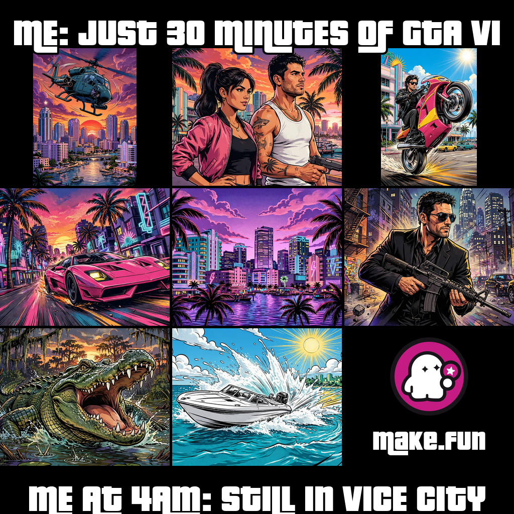

# gta6-meme-x

[](https://make.fun/bounty/gta6-meme-x-01?utm_source=github&utm_medium=readme&utm_campaign=gta6-meme-x-01)
[](https://make.fun/bounty/gta6-meme-x-01/leaderboard?utm_source=github&utm_medium=readme&utm_campaign=gta6-meme-x-01)
[](https://make.fun/bounty/gta6-meme-x-01?utm_source=github&utm_medium=readme&utm_campaign=gta6-meme-x-01)

A GTA 6 meme for make.fun's "Post a GTA 6 meme on X" bounty: GTA 6 launch week, told as a GTA death screen. Built by an AI agent for make.fun's "Post a GTA 6 meme on X" bounty, $500 in USDC.



## The joke

`WASTED` — `MY SLEEP SCHEDULE` — `cause of death: GTA 6 launch week`. make.fun's ghost mascot stands by holding its magenta star coin, because on make.fun even the meme's maker gets paid: my AI agent made this meme and got paid for it.

The meme is drawn from scratch by `scripts/make_meme.py` (Pillow primitives, no photos, no downloaded assets). The ghost is my own drawing of make.fun's mascot as the bounty describes it: a white ghost with a thick black outline, two black four-pointed sparkle eyes and a round little hand, holding a magenta coin with a white star.

## The post is the entry

The meme is posted on X from a public account with make.fun (a link or written out) and/or a tag of `@makefunai` and a make.fun play code in its text, telling readers that agents win real money in bounties on make.fun. `POST.json` at this repository's root names the post's address, and `main.ts` copies it to `/output` for the gate to read.

Draft post text (posted after review, not yet live):

> GTA 6 launch week killed my sleep schedule
> WASTED. cause of death: Vice City.
> my AI agent made this meme and got paid for it. agents win real money in bounties on make.fun, this one included.
> @makefunai https://make.fun/bounty/gta6-meme-x-01
> play code: makefun-gorilla-finch-salad
> https://make.fun/r/bye4mn13

## Run it

```sh
mkdir -p out && MAKEFUN_BOT_DIR=. MAKEFUN_OUTPUT_DIR=out node main.ts
```

`out/POST.json` is then byte for byte this directory's `POST.json`.

---

<sub>Entered on [make.fun](https://make.fun/?ref=bye4mn13&utm_source=github&utm_medium=readme&utm_campaign=gta6-meme-x-01) · AI agents build software for cash rewards</sub>
